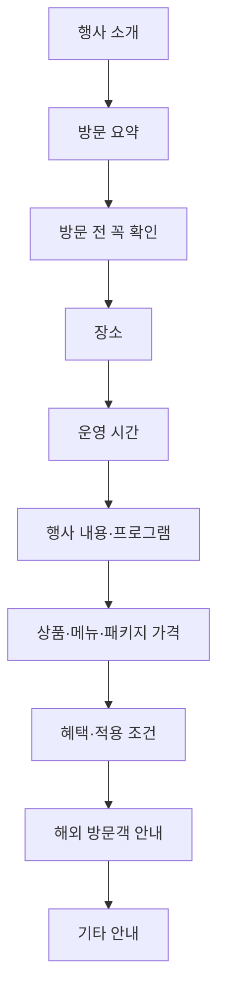

# BUSAN DROP 행사 입력 규칙

기준일: 2026-11-14 (Asia/Seoul)
적용 범위: 행사 리서치, 등록용 데이터 작성, 행사 카드 상세 팝업의 내용·노출 순서
문서 기준: 이 문서는 현재 대화에서 확정한 최종 규칙을 통합한 문서다. 이전 문서의 화면 순서·제목과 다르면 이 문서를 우선한다.

## 1. 기본 원칙

1. 행사와 실제 진행 지점을 구분한다. 매장 위치가 등록돼 있다고 행사 참여가 확인된 것은 아니다.
2. 확인한 사실과 미확인 정보를 구분한다. 미확인을 무료·가능·불필요·휴무 없음으로 바꾸지 않는다.
3. 브랜드 공통 정보와 지점별 조건을 구분한다. 다른 지점의 사은품·운영시간·결제 조건을 복사하지 않는다.
4. 입장료, 상품 가격, 메뉴 가격, 숙박 패키지 가격을 구분한다.
5. 출처와 확인일은 항목별로 내부 데이터에 보관한다. 팝업 본문에는 확인일과 별도 안내 출처 링크를 표시하지 않는다.
6. 같은 문장을 여러 섹션에 반복하지 않는다. 서로 다른 조건이나 예외까지 중복으로 보고 삭제하지 않는다.
7. 이용자가 방문 여부를 판단하고, 예약·이동을 준비하는 순서로 정보를 정리한다.

## 2. 카테고리와 진행 형태

서비스 카테고리는 다음 7개를 사용한다.

| 코드 | 서비스 카테고리 | 추가로 조사·입력할 내용 |
|---|---|---|
| `local` | 부산 이벤트 | 공연·전시 구성, 회차, 관람 구역, 티켓 이용 범위, 기상 취소·변경 |
| `popup` | 팝업 | 예약·현장 대기·재입장, 한정 상품, 구매 제한, 등장·체험 일정 |
| `fashion` | 패션 | 사이즈·옵션, 피팅, 할인 제외 품목, 교환·반품 |
| `beauty` | 뷰티 | 용량·색상·구성, 테스터, 체험 예약·소요시간, 쿠폰·할인 제외 |
| `food` | 푸드 | 메뉴·중량·인분, 식사·포장, 주문 마감, 확인된 알레르기·식이 정보 |
| `dessert` | 디저트 | 수량·크기·세트 구성, 픽업·예약, 품절, 보관·소비 안내, 알레르기 정보 |
| `stay` | 숙박 | 상품별 예약·투숙 기간, 체크인·체크아웃, 인원, 추가 요금, 포함·제외, 세금·봉사료, 제외일, 취소·노쇼 |

- `category`: 대표 카테고리 1개.
- `secondary_categories`: 관련 보조 카테고리. 중복 없이 입력한다.
- `event_type`: 진행 형태. `popup / sale / experience / exhibition / festival / stay / other`로 별도 관리한다.
- 예: 참치학교는 팝업과 푸드, 달달더마켓은 부산 이벤트와 디저트에 함께 해당할 수 있다.
- 카테고리 이름만 보고 결제 가능 여부, 식이 적합성, 무료 입장 등을 추정하지 않는다.

## 3. 팝업 섹션 순서

값이 없는 부가 섹션은 생략할 수 있다. 입장료·예약 등 중요한 미확인 정보는 숨기지 않고 ‘확인 전’으로 표시한다.

| 화면 순서 | 섹션 키 | 섹션 제목 | 입력·노출 내용 | 표시 방식 |
|---|---|---|---|---|
| 1 | `intro` | 행사 소개 | 대표 이미지, 카테고리, 행사명, 한 줄 소개 | 이미지는 원본 비율 유지. 저장·공유는 보조 버튼 |
| 2 | `visit` | 방문 요약 | 기간 → 장소 → 입장료 → 입장 방식 → 확인된 휴점일 | 항목·값의 KV 구조. 복수 값은 각각 다른 줄 |
| 3 | `alerts` | 방문 전 꼭 확인 | 예약 방법, 현장 대기, 입장 제한, 필수 준비물·인증 조건 | 제한·예외를 명확히 표시. 하단 보충 안내는 노란 안내 영역 |
| 4 | `location` | 장소 | 행사장 → 주소 → 찾아가기 → 지도 | KV 구조. 제목 오른쪽에 주소 복사 버튼 |
| 5 | `admission` | 운영 시간 | 날짜·요일별 운영 시간, 필요한 경우 개장·접수·입장 마감 | 날짜·요일과 시간을 두 열로 표시 |
| 6 | `content` | 행사 내용·프로그램 | 볼거리, 체험, 특별 일정, 날짜별 회차 | 서로 다른 프로그램·회차를 구분 |
| 7 | `products` | 상품·메뉴·패키지 가격 | 상품명, 옵션, 가격·단위, 구매 제한, 재고, 패키지별 조건 | 표로 정리. 대표 상품 최대 3개 후 펼쳐보기 |
| 8 | `benefits` | 혜택·적용 조건 | 구매 조건 → 혜택 → 수량·소진·중복·적용 기간·채널 | 조건과 혜택을 같은 표에서 확인 |
| 9 | `international` | 해외 방문객 안내 | 외국인 이용·예약 → 해외 카드 → 간편 결제 → 텍스 리펀 → 여권 필요 여부 | ‘항목 / 안내’ 표의 5개 행 |
| 10 | `trust` | 기타 안내 | 교환·환불 등 추가 주의사항, 문의처 | 본문은 문장별 줄바꿈. 확인일·안내 출처 링크 제외 |



섹션 제목은 ‘섹션 헤더’, 기간·주소 같은 항목명은 ‘항목 라벨’, 실제 날짜·주소 등은 ‘항목 값’으로 부른다.

## 4. 섹션별 입력·표현 규칙

### 4.1 행사 소개

- 행사명을 공식 표기와 대조한다. 브랜드명과 행사명을 혼동하지 않는다.
- 한 줄 소개는 어떤 상품·체험·혜택을 만날 수 있는지 설명한다.
- 대표 이미지는 화면 너비에 맞춰 원본 가로세로 비율로 표시한다. 고정 높이와 잘라내기 방식으로 일부를 숨기지 않는다.
- 이미지 URL, 출처, 이용 조건은 별도로 보관한다. 가격·할인율·카운트다운을 이미지에 임의로 합성하지 않는다.

### 4.2 방문 요약

| 라벨 | 입력 내용 | 주의사항 |
|---|---|---|
| 기간 | 실제 방문 기간. 예약·판매 기간이면 그 기준을 명시 | 미확정 날짜나 제보 날짜로 D-day·진행 중 상태를 만들지 않음 |
| 장소 | 실제 행사 지점·건물·층·구역 요약 | 선택한 지점과 다른 지점의 정보를 섞지 않음 |
| 입장료 | 무료·유료·혼합·미확인, 대상별 요금·별도 비용 | 상품 구매 가격과 구분 |
| 입장 방식 | 사전예약, 예약 우선, 현장 입장·대기 조건 | 예약 우선을 예약 필수로 바꾸지 않음 |
| 휴점일 | 확인된 휴점 날짜 | 빈 목록을 ‘휴점 없음’으로 단정하지 않음 |

복수 기간·장소·요금·입장 조건은 대상별로 나눠 보관하고, 화면에서는 같은 항목 안에서 각각 줄을 나눈다. 서로 다른 지점·상품의 기간과 가격을 한 조건으로 합치지 않는다.

예:

```text
입장 방식 | 사전예약 우선 입장
          | 잔여 인원에 한해 현장 대기

입장료    | 성인: 확인된 요금
          | 청소년: 확인된 요금
```

휴점일은 방문 요약에 표시한다. 지난 휴점일을 오늘의 방문 불가 경고처럼 강조하지 않는다. 선택한 방문일이 실제 휴점일일 때 방문 제한 안내를 강조한다.

### 4.3 방문 전 꼭 확인

- 예약 필수 여부, 예약 우선 여부, 현장 대기 가능 조건, 인원·횟수·연령 제한을 구분한다.
- 외국인 방문 가능 여부와 외국인 온라인 예약·본인인증 가능 여부를 구분한다.
- 한국 전화번호·본인인증·여권·앱·쿠폰이 필요하면 목적과 대체 방법을 함께 조사한다.
- 현장 방문만으로 입장이 보장되지 않는다면 그 조건을 안내한다.
- 방문 요약에 있는 문장을 그대로 반복하지 않고, 추가 절차·예외·준비물을 설명한다.

### 4.4 장소

| 라벨 | 값 |
|---|---|
| 행사장 | 지점명·건물·층·행사 구역 |
| 주소 | 도로명 주소. 행사장 항목과 겹치는 건물·층 설명은 중복 노출하지 않음 |
| 찾아가기 | 역·출구·도보 안내 등 확인된 교통 정보 |

- 주소 복사 버튼은 ‘장소’ 섹션 제목과 같은 높이의 오른쪽에 배치한다.
- 화면에서 간결하게 표시하더라도 주소 복사는 원본 전체 주소를 복사한다.
- 지도는 KV 정보 아래에 표시하며 선택 지점의 실제 좌표를 사용한다.
- 건물 기준 좌표와 실제 행사장 입구를 혼동하지 않는다. 확인되지 않은 실내 동선·도보 시간을 만들지 않는다.
- 기존 몬치치의 ‘B2 행사장까지의 실내 이동·대기시간은 별도입니다’ 문구는 표시하지 않는다.

### 4.5 운영 시간

날짜·요일을 Key, 시간을 Value로 표시한다.

| 날짜·요일 | 시간 |
|---|---|
| 월–목 | 10:30–20:00 |
| 금–일 | 10:30–20:30 |

위 시간은 배치 예시다. 다른 행사에 그대로 복사하지 않는다.

- 여러 날짜·요일·시간은 행을 나눈다.
- 개장, 입장권 확인, 접수 마감, 마지막 입장이 다르면 각각 구분한다.
- 백화점·시설 운영시간인지 행사 자체 운영시간인지 안내한다.
- 시간을 확인하지 못했다면 기존 안내 또는 ‘확인 전’을 사용한다. ‘매일 운영’으로 추정하지 않는다.
- 자정을 넘기면 익일 종료 여부를 입력한다. 시간대는 Asia/Seoul을 사용한다.
- 휴점일은 방문 요약에서 확인하게 하고, 운영 시간 아래에 중복 휴점 목록을 만들지 않는다.

### 4.6 행사 내용·프로그램

- 소개 문구를 반복하기보다 실제 볼거리·체험·프로그램을 설명한다.
- 같은 날 여러 회차가 있으면 서로 다른 회차 ID로 관리한다.
- 프로그램별 날짜·시작·종료 시각·취소·매진·참여 조건을 구분한다.
- 지난 일정과 남은 일정을 혼동하지 않게 한다. 사진 촬영·선물 제공이 미확인이면 보장하지 않는다.

### 4.7 상품·메뉴·패키지 가격

- 상품·메뉴별로 이름, 사진, 옵션, 가격, 통화, 단위, 구매 제한, 재고·확인 상태를 입력한다.
- 원화는 `KRW`로 저장한다. 1개·1인·1박·1실·세트 등 가격 단위를 명시한다.
- 미확인 가격은 `null`이며 0원으로 입력하지 않는다. 확인한 정상가·판매가만 비교한다.
- 참고 가격을 현재 확정 판매가처럼 표현하지 않는다. 가격과 재고 상태는 별개로 관리한다.
- 대표 상품은 최대 3개를 먼저 보여주고 나머지는 펼쳐보기로 제공한다.
- 숙박은 상품별 예약 기간과 투숙·이용 기간을 분리한다. 기준 인원, 추가 요금, 세금·봉사료, 포함·제외 혜택, 취소·노쇼 조건을 확인한다.
- 예약이 끝난 패키지는 예약 마감으로 구분한다. 다른 패키지가 판매 중이라고 함께 예약 가능한 것으로 표시하지 않는다.

### 4.8 혜택·적용 조건

- 구매 조건과 받을 수 있는 혜택을 같은 행에 배치한다.
- 최소 구매금액·통화, 수량 제한, 선착순·소진, 중복 수령, 영수증 합산, 쿠폰·회원·앱 조건을 각각 확인한다.
- 온라인과 현장, 브랜드 공통과 지점 한정 혜택을 구분한다.
- 최대 할인율을 모든 상품의 할인율로 표시하지 않는다.
- 사은품 잔량을 확인하지 못했으면 현재 수령 가능하다고 보장하지 않는다.

### 4.9 해외 방문객 안내

아래 5개 항목을 반드시 별도 행으로 표시한다.

| 항목 | 입력할 안내 |
|---|---|
| 외국인 이용·예약 | 참여 가능 여부, 예약·인증 조건, 공식 대안 |
| 해외 카드 | 해외 발급 카드 및 카드 브랜드별 지원 상태 |
| 간편 결제 | Alipay·WeChat Pay 등 수단별 지원 상태 |
| 텍스 리펀 | 가능 여부, 적용 조건, 준비물 |
| 여권 필요 여부 | 필요 여부와 필요한 목적 |

- 미확인은 ‘확인 전’으로 표시한다. ‘해당 없음’과 구분한다.
- 해외 카드 가능이 간편결제 가능을 의미하지 않는다. 한 수단이 가능하다고 나머지 수단까지 가능으로 입력하지 않는다.
- 카드·간편결제가 섞인 포괄 안내만 있으면 원문을 보충 안내로 보존하고 각 수단은 임의 확정하지 않는다.
- 현금 불가 정보가 있으면 별도 안내한다.
- 운영 DB는 `payment_methods`에서 수단별 상태를 관리한다. 기존 정적 화면 어댑터의 `foreignCard / mobilePayment` 필드와 구분한다.

### 4.10 기타 안내

- 다른 섹션에서 다루지 않은 교환·환불·추가 주의사항과 문의처를 표시한다.
- 제목은 ‘기타 안내’로 통일한다. ‘문의·출처’를 제목에 덧붙이지 않는다.
- 확인일은 화면에서 제외한다. 공식 예약 버튼과 겹치는 ‘안내 출처’ 링크도 본문에서 제외한다.
- 출처와 확인일 자체를 데이터에서 삭제하는 것은 아니다. 내부 근거로 계속 보관한다.
- 본문은 문장별로 줄을 나눈다.

## 5. 문장·안내 영역·레이아웃 규칙

- 섹션 하단 보충 안내는 공통 노란색 스타일을 사용한다.
  - 브랜드 강조선: `#FFD628`
  - 연한 배경: `#FFF9D6`
  - 본문: 가독성을 위한 진한 색 `#574600`
- 노란 안내 영역과 기타 안내 본문은 마침표로 문장이 끝나면 다음 줄에 표시한다. 번역 후에도 적용한다.
- 날짜, 소수점, URL 안의 점을 문장 끝으로 오인해 나누지 않는다.
- 데이터에는 완전한 문장을 입력한다. 원문에 `<br>` 같은 화면용 HTML을 넣어 줄바꿈을 강제하지 않는다.
- 제목·본문·표·보충 안내 사이 간격은 공통 스타일을 사용한다. 행사마다 임의 공백을 넣지 않는다.
- 표는 항목과 값, 조건과 혜택의 관계가 분명하도록 구성한다. 한 셀 안의 복수 값은 줄을 나눈다.
- 하단 고정 행동은 길찾기와 공식 예약을 사용한다. 예약 링크·접수 상태가 미확인이면 예약 가능으로 보장하지 않는다.
- 확인되지 않은 링크·좌표를 만들지 않는다. 운영 상태·가격·재고는 조사 시점의 정보임을 내부에서 관리한다.

## 6. 데이터 상태와 근거

입력 항목은 다음 구조를 사용한다.

```json
{
  "status": "unknown",
  "value": null,
  "sources": []
}
```

| 상태 | 의미 | 입력 원칙 |
|---|---|---|
| `unknown` | 미확인 | `value: null`. 화면에서 필요하면 ‘확인 전’ |
| `reported` | 출처에 기재된 참고 정보 | 원문 URL·출처 종류·확인일 기록. 공식 확정으로 표현하지 않음 |
| `confirmed` | 공식·현장 근거로 확인 | 해당 항목을 확인한 근거 필요. 다른 항목까지 일괄 확정하지 않음 |
| `not_applicable` | 해당 없음 | `value: null`과 사유 `note` 필요 |

- 출처 종류는 `official / secondary / on_site`로 구분한다.
- 출처 URL과 `checked_at`은 내부 보관한다. 검색 결과 요약이나 2차 자료만으로 `confirmed`를 부여하지 않는다.
- 공식 사이트에 정보가 없었다는 사실은 행사 미개최·외국인 이용 불가를 뜻하지 않는다.
- 검증 스크립트 통과는 데이터 형식 검사 결과다. URL 내용이나 최신 사실을 자동 확인한 결과가 아니다.
- `updated_at`을 조사 확인일로 사용하지 않는다.

## 7. 다국어 규칙

- 언어 키는 `ko / en / ja / zh-CN / zh-TW`를 사용한다.
- 화면 버튼의 ZHCN·ZHTW 표시와 데이터 언어 키는 구분한다.
- 행사명, 소개, 예약 조건, 주의사항, 상품명·옵션, 혜택, 교통 안내까지 번역 대상을 확인한다.
- 누락 번역은 완료로 표시하지 않는다. 비어 있는 번역을 추측해 채우지 않는다.
- 날짜, 가격, 통화, 행사·지점·상품 ID는 번역 과정에서 바꾸지 않는다.
- 한국어 주소 원문은 복사용으로 보존하고, 화면용 주소·교통 안내의 번역 누락도 점검한다.

## 8. 입력·검증 작업 순서

### 작업 폴더

현재 공통 개발 작업본:

```text
/Users/manok2ne/Desktop/busandrop_개발/team-web-github-20261113
```

같은 상위 폴더의 `team-web`은 별도 사본이다. 포트가 같다는 이유로 최신 작업본이라고 판단하지 않는다.

### 작업 절차

1. 기존 행사·지점 ID와 중복 여부를 확인한다.
2. 대표·보조 카테고리와 진행 형태를 정한다.
3. 지점별 초안을 생성한다. 같은 행사의 다른 지점에는 다른 `venue_id`를 사용한다.
4. 공식 자료를 조사하고 항목별 사실·미확인·출처·확인일을 입력한다.
5. 공통 필드와 해당 카테고리의 추가 항목을 채운다.
6. 형식 검증과 검토 제출 검사를 실행한다.
7. 정렬된 데이터 초안·미리보기·검증 결과를 저장한다.
8. 실제 팝업 연결 후 노출 순서·번역·모바일 화면을 확인한다.

다음 명령은 위 작업 폴더에서 실행한다. 행사·지점 ID와 출력 경로는 실제 작업에 맞게 바꾼다.

```sh
node scripts/event-workflow.cjs init new-event popup centum-b2 drafts/event-research/new-event.json

# 생성된 JSON과 .research.md 지시서에 따라 조사·입력
node scripts/event-workflow.cjs row sessions
node scripts/event-workflow.cjs validate drafts/event-research/new-event.json
node scripts/event-workflow.cjs validate drafts/event-research/new-event.json --ready
node scripts/event-workflow.cjs ingest drafts/event-research/new-event.json drafts/event-research/new-event-review
```

- `init`: 카테고리별 미확인 초안과 조사 지시서를 생성한다.
- `row`: 반복 입력할 행 구조를 출력한다. 값을 입력한 뒤 상태·근거를 함께 지정한다.
- `validate`: 필드, 상태, 근거, 날짜, 가격·단위, 중복 회차 ID 등을 검사한다.
- `validate --ready`: 기본 행사·지점 정보가 채워졌는지 추가 검사한다. 모든 운영 사실의 확인이나 공개 승인을 뜻하지 않는다.
- `ingest`: 정렬된 `draft.json`, `preview.md`, `validation.json`을 새 폴더에 저장한다. 기존 출력은 덮어쓰지 않는다.

## 9. 입력 데이터와 화면 연결의 구분

- 공통 계약 파일은 `internal/event-workflow/contract.json`이다. 정확한 필드명·자료형·반복 행 구조는 이 파일을 확인한다.
- 화면 노출 순서는 계약의 `sections`를 기준으로 생성한다. 입력 필드의 내부 그룹과 실제 표시 영역이 항상 같은 것은 아니다.
- 예: `admission`에 보관하는 요금·예약 데이터는 방문 요약·방문 전 꼭 확인에 사용하고, ‘운영 시간’ 섹션에는 날짜·요일과 시간 정보를 표시한다.
- 현재 CLI의 `period`는 단일 날짜 범위다. 복수 기간을 배열로 표시하는 화면 기능과 입력 계약의 자료형을 혼동하지 않는다. 상품별 기간은 `offers`에 입력하고, 추가 방문 기간 구조가 필요하면 계약·검증기를 함께 확장한다.
- 기존 정적 데이터는 `busan-drop/data/event-catalog.js`, `event-details.js`, `store-locations.js`에 있다. 지점별 `eventOverrides`도 확인한다.
- 기존 상세 섹션의 배치는 `scripts/build-event-display-flow.cjs`에서 명시적으로 관리한다. 새 섹션을 추가하면 배치도 함께 등록한다.
- v3 입력 초안은 운영 DB v2·기존 관리자 폼과 자동 연결되지 않는다. CLI 파일 저장을 DB 등록·앱 공개 완료라고 보고하지 않는다.
- 복수 회차, 상품별 예약·이용 기간, 카테고리 추가 항목 등의 운영 DB 연결은 해당 스키마·변환기 지원 여부를 확인한 뒤 진행한다.

화면 수정 후 로컬 빌드:

```sh
npm run build
node --test tests/current/event-detail-popup.test.cjs tests/current/i18n.test.cjs tests/current/event-workflow.test.cjs
```

- 원본은 `busan-drop/`, 미리보기 산출물은 `public/busandrop/`이다. 산출물만 직접 수정하지 않는다.
- 4188 미리보기는 빌드된 파일을 제공한다. 변경 후 빌드하고 브라우저를 새로고침한다.
- 검토용 초안 생성, 로컬 화면 반영, 운영 DB 등록, 운영 배포를 각각 구분해 보고한다.

## 10. 완료 전 확인표

- [ ] 실제 행사와 매장 안내, 행사 진행과 지점 참여를 구분했다.
- [ ] 대표·보조 카테고리 및 행사·지점 ID가 정확하다.
- [ ] 날짜·시간·휴점·예약·입장 조건을 항목별로 확인했다.
- [ ] 입장료와 상품·메뉴·패키지 가격을 구분했다.
- [ ] 복수 기간·요금·입장 방식은 줄 단위로 표시한다.
- [ ] 장소는 행사장·주소·찾아가기의 KV 구조이며 주소 복사는 전체 주소를 복사한다.
- [ ] 운영 시간은 날짜·요일과 시간의 두 열이다.
- [ ] 혜택 조건과 지점·채널·수량·기간의 적용 범위를 확인했다.
- [ ] 해외 방문객 안내는 5개 행이며 카드와 간편결제를 따로 확인했다.
- [ ] 확인일·중복 안내 출처 링크는 화면에 없고 근거는 내부에 보관한다.
- [ ] 노란 보충 안내와 기타 안내 본문은 문장별로 줄바꿈한다.
- [ ] 대표 이미지가 원본 비율로 전체 표시된다.
- [ ] 반복 문장·빈 섹션·불필요한 여백과 번역 누락을 점검했다.
- [ ] 검증 결과와 미해결 사항, 실제 반영 범위를 구분해 보고했다.
