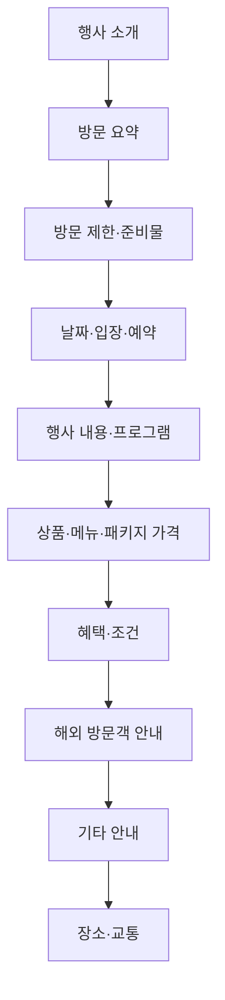

# BUSAN DROP 공통 행사 리서치·입력·팝업 노출 규격 v3

작성일: 2026-11-14 · 7개 서비스 카테고리 공통

최종 입력·화면 규칙: [행사 입력 규칙](../../docs/행사_입력규칙.md).

**입력은 파일 기반 검토 규격이며, 공통 영역 순서는 로컬 팝업 렌더러에 연결했다. Supabase v2 DDL 변경·데이터 자동 등록은 수행하지 않았다.**

## 검수 범위와 결과

`team-web-github-20261113`의 카탈로그 20개, 상세 19개, 지점 연결 33개를 전수 검사했다. 2026-11-14 KST 종료 필터 기준 행사 13개·지점 24개. 카테고리별 건수는 중복 포함이다.

공식 웹사이트 재조사·실제 운영 DB 조회는 이번 검수에 포함하지 않았다. 출처·날짜·가격은 등록된 내용이며 현재 운영 사실을 새로 확인한 결과가 아니다. 검수 원본과 각 지점의 덮어쓰기는 `audit-20261114/audit.json`에 보존했다.

|카테고리|등록 행사|종료 제외|추가 입력 항목|
|---|---:|---:|---|
|부산 이벤트|3|2|공연·전시 구성 / 기상 취소·변경 / 관람권 이용 범위|
|팝업|10|7|예약·현장 대기·재입장 / 한정 상품·구매 제한 / 등장·체험 회차|
|패션|3|3|사이즈·옵션 / 피팅 여부 / 교환·반품 / 할인 제외 품목|
|뷰티|1|0|용량·색상·구성 / 테스터·체험 / 시술/체험 예약·소요시간 / 쿠폰·할인 제외|
|푸드|1|1|메뉴·중량·인분 / 매장 식사·포장 / 주문 마감 / 확인된 알레르기 정보 / 확인된 식이 정보|
|디저트|1|0|수량·크기·세트 구성 / 보관·소비 안내 / 확인된 알레르기 정보 / 픽업·예약·품절|
|숙박|3|1|체크인·체크아웃 / 기준·최대 인원·추가 요금 / 객실/식사/체험 구분 / 제외일 / 세금·봉사료 / 취소·노쇼|

팝업은 진행 형태이면서 탐색 카테고리이기도 하다. `category`는 대표 카테고리 1개, `secondary_categories`는 나머지 관련 카테고리다. `event_type`은 세일/팝업/공연·체험 등 진행 형태로 별도 입력한다. 참치학교는 팝업+푸드, 달달더마켓은 부산 이벤트+디저트로 중복 탐색한다. 카테고리만 보고 음식의 식이 적합성이나 예약·결제 가능 여부를 추정하지 않는다.

## 공통 사용자 흐름과 입력·노출 순서




행사 이해 → 방문 가능 여부 → 입장 준비 → 경험 → 상품·가격 → 혜택 → 해외 방문 조건 → 기타 안내 → 이동

|순서|영역 / 사용자 질문|영역 안 입력·노출 순서|표시 규칙|
|---|---|---|---|
|10|행사 소개 / 어떤 행사인가?|행사명 → 한 줄 소개 → 대표 이미지·출처·이용 조건 → 진행 형태: popup/sale/experience/exhibition/festival/stay/other → 참여 대상|핵심 미확인은 명시; 빈 값으로 가능/무료 추정 금지|
|20|방문 요약 / 내 여행 날짜에 갈 수 있나?|실제 방문 기간 → 지점·층 요약 → 운영시간 요약·백화점/행사 기준 구분 → 입장료 상태: free/paid/mixed/unknown/not_applicable → 예약 방식: required/optional/priority/not_required/unknown/not_applicable → 외국인 예약 가능 여부: available/unavailable/conditional/unknown/not_applicable|핵심 미확인은 명시; 빈 값으로 가능/무료 추정 금지|
|30|방문 전 꼭 확인 / 헛걸음할 조건이 있나?|입장 제한·예약 필수·휴점 경고 → 한국 번호·본인인증·여권·앱·쿠폰 필요 조건|선택 방문일의 경고만 강조; 지난 휴점 강조 해제|
|40|날짜·입장·예약 / 어떻게 입장하나?|요일별 운영시간·마지막 입장·접수 마감 → 휴점·특별 영업 → 입장료·연령·통화·별도 비용 → 예약 접수 기간 → 공식 예약 URL → 현장 입장·대기 조건 → 한국 번호/인증 불가 시 공식 대안|핵심 미확인은 명시; 빈 값으로 가능/무료 추정 금지|
|50|행사 내용·프로그램 / 가면 무엇을 경험하나?|행사 내용 → 특별 프로그램·날짜별 복수 회차|소개는 노출, 긴 설명/지난 회차는 펼쳐보기|
|60|상품·메뉴·패키지 가격 / 무엇을 얼마에 이용하나?|상품·메뉴·옵션·구매 제한·재고 → 패키지별 예약·이용 기간·가격·인원·포함/제외|대표 상품 최대 3개 후 전체 보기; 상품 없는 행사는 해당 없음|
|70|혜택·적용 조건 / 어떤 조건에서 혜택을 받나?|구매 기준 → 혜택 → 수량·소진·중복·채널·기간|조건과 혜택을 같은 묶음에 표시|
|80|해외 방문객 안내 / 입장·결제·준비가 가능한가?|외국인 방문·예약 조건 → 해외 카드·현금·간편결제 각각 → 환급 가능 여부·조건 → 여권 필요 목적·준비물|입장·예약을 막는 조건은 30번에도 요약|
|90|기타 안내 / 무엇을 언제 확인한 정보인가?|취소·환불·기타 주의사항 → 문의처 → 공식 행사 안내 URL → 이번 리서치 확인 범위·미해결 사항|문의·주의사항 표시; 출처·확인일은 본문에서 제외|
|100|장소·교통 / 어떻게 찾아가나?|실제 지점명 → 한국어 주소·복사용 → 건물·층·구역 → 좌표·건물/입구 기준·정확도 안내 → 역·출구·도보 안내 → 휠체어·유아 동반 등 확인 정보|주소·층·교통 다음 지도|

`category_details`는 해당 카테고리 확장 항목이다. 실제 정보 성격에 따라 40(입장/마감), 50(체험), 60(메뉴/패키지), 80(해외 준비) 영역에서 표시한다. DB 물리 컬럼 순서와는 무관하다.

## 표시와 날짜 규칙

- 방문 요약은 예약 접수 기간 대신 실제 방문/이용 기간을 우선 표시한다. 일정 미확정이면 날짜·D-day·진행 중을 만들지 않는다.
- 여행 날짜가 선택되면 그 날짜를 기준으로 휴점/입장 경고를 판정한다. 선택 날짜가 없으면 Asia/Seoul 오늘을 사용한다.
- 같은 날 12:00와 15:00 회차는 별도 ID로 관리한다. 공연 취소·매진 상태는 회차별로 기록한다.
- 브랜드 공통 혜택과 특정 지점 적용 여부를 분리한다. 지점마다 초안 1개를 만들고 동일한 행사 ID와 다른 venue_id를 사용한다.
- 숙박은 상품별 예약 접수 기간과 투숙/이용 기간, 1박/1실/1인 단위, 인원, 세금·봉사료, 포함/제외, 제외일, 취소 조건을 함께 관리한다. 종료된 예약 상품은 다른 상품과 별도 표시한다.
- 입장료·상품가·최저 패키지가는 합산하지 않는다. min_purchase에도 통화를 명시한다. 빈 가격은 0원으로 바꾸지 않는다.
- 가격/재고/증정 잔량/예약 가능 회차의 확인일을 구분한다. 공식 출처라도 과거 확인 기록은 실시간 재고나 판매 보장이 아니다.
- 음식 알레르기/식이/보관 안내는 공식 확인 내용만 입력한다. unknown은 안전·할랄·비건·섭취 가능을 의미하지 않는다.
- 핵심 미확인(입장료, 예약 가능 여부)은 표시한다. 부가 미확인은 요약 후 펼칠 수 있다. not_applicable는 사유 note를 기록하고 화면에서는 숨길 수 있다.
- 저장·공유는 상단 보조 행동. 하단은 길찾기·공식 예약. 예약 링크/현재 접수 여부가 확인되지 않으면 예약 가능으로 표시하지 않고 공식 안내 확인으로 구분한다. 길찾기는 실제 지점 좌표/주소가 있을 때만 연결한다.

## 항목별 근거 포맷

각 필드는 `{status,value,sources}`로 입력한다. status는 unknown/reported/confirmed/not_applicable. unknown과 not_applicable는 value=null이며 해당 없음에는 사유 note가 필요하다. known 배열의 각 행도 같은 근거 구조를 사용한다. 행의 세부 미확인 값은 null로 둔다. 공식 출처와 확인일이 있다고 해서 모든 행 전체를 일괄 확정하지 않는다.

```json
{
  "status": "reported",
  "value": {
    "ko": "사전예약 우선·현장 대기 조건부"
  },
  "sources": [
    {
      "kind": "secondary",
      "url": "https://example.com/source",
      "checked_at": "2026-11-14"
    }
  ]
}
```

위 URL은 포맷 예시이며 실제 근거가 아니다. 리서치 시 실제로 확인한 원문으로 교체한다. i18n은 ko/en/ja/zh-CN/zh-TW만 허용한다. 누락 번역은 경고하며, 미입력 번역을 완료로 간주하지 않는다. 입력 스크립트는 URL을 열거나 사실 여부를 자동 판정하지 않는다.

## 실행

프로젝트 루트에서 다음 순서로 사용한다. 기존 파일은 덮어쓰지 않는다.

```sh
node scripts/event-workflow.cjs init new-event popup centum-b2 drafts/event-research/new-event.json
# 생성된 JSON과 .research.md 작업 지시서를 따라 조사·입력
node scripts/event-workflow.cjs row sessions
# 출력한 행 틀을 채우고 근거와 상태를 지정한 뒤 sessions.value 배열에 추가
node scripts/event-workflow.cjs validate drafts/event-research/new-event.json
node scripts/event-workflow.cjs validate drafts/event-research/new-event.json --ready
node scripts/event-workflow.cjs ingest drafts/event-research/new-event.json drafts/event-research/new-event-review
```

init의 카테고리: local / popup / fashion / beauty / food / dessert / stay. 보조 카테고리를 넣으면 해당 확장 필드도 category_details에 추가해야 한다. row 출력은 편집할 구조 예시이므로 값을 입력한 다음 상태도 변경해야 한다.

validate는 형식·근거·날짜·가격·단위·중복 회차 ID를 검사한다. --ready는 행사명·소개·지점명·주소·공식 안내가 채워졌는지 추가 검사한다. 일정 미확정 초안도 제출할 수 있으나 매장 안내와 행사 공개를 분리 검토하라는 경고가 남는다. 경고가 없는 것이 사실 검증 완료나 공개 승인을 의미하지 않는다.

ingest는 이 검사를 통과한 데이터를 계약 순서로 정렬해 draft.json / preview.md / validation.json으로 저장한다. DB INSERT, 기존 데이터 수정, 앱 공개, 이미지 생성은 수행하지 않는다.

다음 전수 검수:
```sh
node scripts/audit-event-content.cjs 2026-11-15 internal/event-workflow/audit-20261115
node --test tests/current/event-workflow.test.cjs
```

## DB v2 연결 전에 필요한 보완

1. 프로그램/복수 회차 구조: 기존 schedule_exceptions의 일자+유형 유니크 제약으로 같은 날 여러 session을 저장할 수 없다.
2. 상품별 예약/이용 기간·단위·인원·세금·취소 조건: 기존 단일 event_venues 기간과 제품 옵션만으로 충분하지 않다.
3. 메뉴·식이·보관 등 카테고리별 확장 구조와 혜택 구매 기준의 통화/소진 상태.
4. 내부 evidence를 그대로 공개하지 않고 공개 출처·확인일만 제공하는 서버 응답/뷰.

위 항목은 신규 입력 계약에 표현되어 있지만 운영 SQL 마이그레이션은 이번에 실행하지 않았다. 기존 관리자 v2 폼 내보내기와도 자동 호환되지 않는다. 향후 리서치 입력은 본 v3 CLI를 사용하고, DB 연결 시 명시적 변환기를 구현한다.

## 팝업 화면 연결 (2026-11-14)

공통 contract.json의 영역 순서는 build-event-display-flow.cjs가 브라우저용 event-display-flow.js로 생성한다. 기존 19개 상세 행사와 지점 예외 섹션을 명시적으로 분류해 팝업에서 공통 순서로 렌더링한다. 신규 섹션 추가 시 해당 생성 스크립트의 배치를 함께 등록한다. 미등록 섹션은 빌드를 실패시켜 임의 배치를 막는다. v3 초안의 운영 DB 자동 등록은 여전히 별도 작업이다.

2026-11-14 화면 정리: 기타 안내(90) → 장소·교통(100). 기타 안내에는 주의사항과 문의만 표시하고 출처·확인일은 내부 데이터에 보관한다. 공식 예약 링크는 하단 행동으로 유지한다.

2026-11-14 방문 요약 정리: 기간·장소·입장료·입장 방식의 복수 값은 줄 단위로 분리하고 휴점일을 요약에 표시한다. 운영 시간은 날짜/요일 → 시간의 KV 행으로 표시한다. 기존 예약·입장 상세는 방문 전 꼭 확인 영역에서 유지한다. 휴점일은 운영 시간 아래 별도 접기 영역을 만들지 않는다.

2026-11-14 장소 배치 변경: 방문 전 꼭 확인(30) → 장소(35) → 운영 시간(40). 주소 복사는 장소 제목 오른쪽에 표시한다. 예약·입장 관련 중요 보충 안내는 브랜드 노랑 배경/강조선으로 표시한다. 몬치치 B2 실내 이동·대기시간 문구는 제거했다.

2026-11-14 장소 KV 정리: 행사장(지점·층·구역), 주소(도로명 주소), 찾아가기(역·출구·교통)로 구분하고 지도는 아래에 표시한다. 주소 복사는 원본 전체 주소를 복사한다. 섹션 하단 보충 안내는 공통 노랑 배경/강조선 스타일을 사용한다.

2026-11-14 해외 방문객 안내 표: 외국인 이용·예약 / 해외 카드 / 간편 결제 / 텍스 리펀 / 여권 필요 여부의 5행을 항목·안내 표로 표시한다. 카드와 간편결제의 확인 값은 legacy 화면 어댑터에서 foreignCard/mobilePayment로 분리해 받으며, 포괄적인 payment 문장만 있을 때는 두 항목을 임의 확정하지 않고 공통 보충 안내로 보존한다. 운영 DB 입력은 payment_methods의 수단별 상태를 계속 사용한다.
